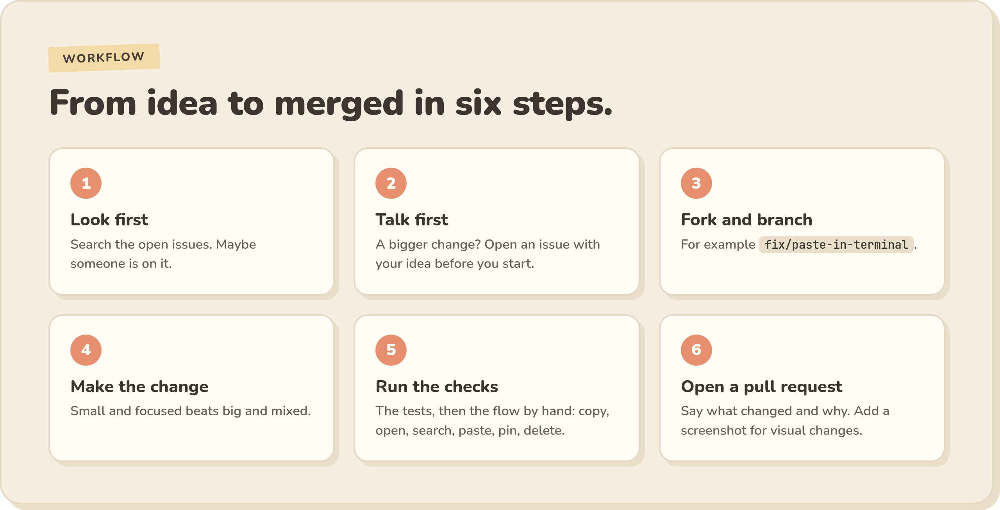
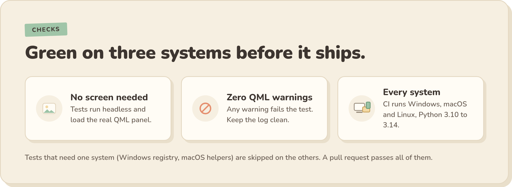

<p align="center">
  
</p>

```bash
clipio version
python --version
```

<p align="center">
  
</p>

## Run it from source

```bash
git clone https://github.com/<your-username>/clipio.git
cd clipio
python -m venv .venv
source .venv/bin/activate          # Windows: .venv\Scripts\activate
pip install -e ".[test]"
clipio run                         # errors and QML warnings show here; Ctrl+C stops it
```

Keep your own history out of the way while you work:

```bash
export CLIPIO_DATA_DIR=/tmp/clipio-dev/data CLIPIO_CONFIG_DIR=/tmp/clipio-dev/config CLIPIO_IPC_NAME=clipio-dev
```

<p align="center">
  
</p>

```bash
python -m pytest -v
```

<p align="center">
  
</p>
