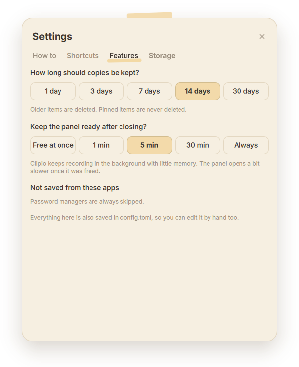

<div align="center">
  
  <h1>Clipio</h1>
  <p><strong>Find and paste anything you copied earlier, with one shortcut.</strong></p>
  <p>A cozy, paper-themed clipboard history that remembers your text, links, colors, code and images.</p>

  <p>
    
    
    
  </p>
  <p>
    <a href="https://github.com/ardazeybek/clipio/releases/latest"></a>
    <a href="https://github.com/ardazeybek/clipio/actions/workflows/ci.yml"></a>
    <a href="LICENSE"></a>
    
  </p>

  <p>
    <a href="https://ardazeybek.github.io/clipio/"></a>
  </p>

  <p>
    <a href="#-features">Features</a> ·
    <a href="#-install">Install</a> ·
    <a href="#%EF%B8%8F-shortcuts">Shortcuts</a> ·
    <a href="#%EF%B8%8F-settings">Settings</a> ·
    <a href="CONTRIBUTING.md">Contribute</a>
  </p>
</div>

<p align="center">
  
</p>

<p align="center"><em>The real Clipio panel: open it, move with the arrow keys, type to search, change settings.</em></p>

---

## ✨ Why Clipio?

- **One shortcut** — press it, pick an earlier copy, and Clipio pastes it where you were typing.
- **Pleasant to look at** — a calm paper theme with note cards, tape and soft animations.
- **Private** — everything stays on your computer. Nothing is uploaded, ever.
- **Light** — only a tiny recorder runs in the background (about 25 MB); the window frees its memory when you are done.
- **Updates itself** — new versions install quietly while you are not using it.
- **Everywhere** — the same app on Windows, macOS and Linux.

## 💻 Works on

| System | Versions | Opens with | Automatic paste |
| :--- | :--- | :---: | :---: |
| **Windows** | 10 and 11 | <kbd>Ctrl</kbd> <kbd>Shift</kbd> <kbd>V</kbd> | Yes |
| **macOS** | Apple Silicon and Intel | <kbd>⌘</kbd> <kbd>⇧</kbd> <kbd>V</kbd> | Yes |
| **Linux X11** | any desktop | <kbd>Super</kbd> <kbd>V</kbd> | Yes |
| **Linux Wayland** | Hyprland, Sway, KDE, GNOME | a key you choose (see *Linux Wayland* below) | Yes (GNOME: copy only) |

## 🌟 Features

### Everyday
| Feature | What it does |
| :--- | :--- |
| **Quick paste** | Pick a card with <kbd>Enter</kbd> or a click; Clipio closes and pastes it. |
| **Search and tabs** | Type to filter; switch between *All*, *Text*, *Images* and *Pinned*. |
| **Pins and folders** | Pinned items never expire. Group them into folders. |
| **Alt + number** | <kbd>Alt</kbd> + <kbd>1</kbd>…<kbd>9</kbd> pastes one of the first nine cards at once. |
| **Paste queue** | Mark several cards and paste them one after another. |

### Smart cards
| Feature | What it does |
| :--- | :--- |
| **Colors** | A swatch, plus the other notation (HEX RGB). |
| **Code** | Colored like in your editor. |
| **Links** | Tracking bits (`utm_…`, `fbclid`…) removed; page titles if you want them. |
| **Images** | Thumbnails, and text read from them (OCR, needs `tesseract`). |
| **Source app** | Every card shows where it came from; type `@firefox` to filter. |
| **Edit and convert** | Edit before pasting, or change case, JSON, Base64, URL encoding. |
| **Templates** | Pinned snippets fill in `{date}`, `{time}`, `{weekday}`, `{clipboard}`… |

### Privacy
| Feature | What it does |
| :--- | :--- |
| **Secrets hide themselves** | Passwords, API keys and card numbers show as dots and vanish after a few minutes. |
| **Ignored apps** | Password managers are always skipped; add any app you like. |
| **Pause** | Stop recording with one click. |
| **Auto cleanup** | Items older than 1–30 days (your choice) are deleted. |
| **Local only** | A small SQLite database on your own disk. |

## 📥 Install

### The easy way (recommended)

1. Open the **[download page](https://ardazeybek.github.io/clipio/)** — it picks the right file for your computer.
2. Open the file and press **Install**.
3. That's it! Clipio starts now and every time you turn on your computer.

No Python, no terminal, no admin rights.

| System | File | First time only |
| :--- | :--- | :--- |
| Windows | `Clipio-Setup.exe` | If SmartScreen appears: **More info → Run anyway** |
| macOS | `Clipio-macOS-AppleSilicon.dmg` or `…-Intel.dmg` | Right-click Clipio → **Open**; allow it under *Privacy & Security → Accessibility* |
| Linux | `Clipio-Setup-Linux` | Or paste the command below into a terminal |

```bash
curl -fsSL https://github.com/ardazeybek/clipio/releases/latest/download/install.sh | sh
```

### Updates

Clipio looks for a new version when it starts and once a day. It downloads it, checks it against a checksum, and installs it quietly while the panel is closed. You'll see a small *"Clipio was updated"* note. Turn it off in **Settings → Features → Automatic updates**, or check right away with `clipio update`.

### Uninstall

| System | How |
| :--- | :--- |
| Windows | **Settings → Apps → Clipio → Uninstall** |
| macOS / Linux | run `clipio uninstall` |

Your history and settings are kept, in case you come back.

<details>
<summary><b>Install with Python (for developers)</b></summary>

Needs Python 3.10–3.14. On Linux also `wl-clipboard` (Wayland) or `xdotool` (X11).

```bash
pipx install git+https://github.com/ardazeybek/clipio.git
clipio start
clipio autostart on
```

Python installs don't update themselves; Clipio tells you when a new version is out (`pipx upgrade clipio`).

</details>

## ⌨️ Shortcuts

**How it works:** copy as usual → press the shortcut → pick a card → it's pasted.

| Key | Action |
| :--- | :--- |
| <kbd>↑</kbd> <kbd>↓</kbd> · <kbd>PgUp</kbd> <kbd>PgDn</kbd> | Move |
| <kbd>Enter</kbd> · click | Paste |
| <kbd>Shift</kbd> + <kbd>Enter</kbd> | Paste cleaned (no tracking, tidy spaces) |
| <kbd>Ctrl</kbd> + <kbd>C</kbd> | Copy only |
| <kbd>Ctrl</kbd> + <kbd>E</kbd> | Edit, then paste |
| <kbd>Ctrl</kbd> + <kbd>M</kbd> · right click | Card menu |
| <kbd>Ctrl</kbd> + <kbd>P</kbd> | Pin or unpin |
| <kbd>Ctrl</kbd> + <kbd>Space</kbd> · <kbd>Ctrl</kbd> + click | Add to the paste queue |
| <kbd>Alt</kbd> + <kbd>1</kbd>…<kbd>9</kbd> | Paste one of the first nine |
| <kbd>Del</kbd> | Delete |
| <kbd>Tab</kbd> · <kbd>Shift</kbd> + <kbd>Tab</kbd> | Next / previous tab |
| <kbd>Esc</kbd> | Clear the search, then close |
| <kbd>Ctrl</kbd> + <kbd>,</kbd> | Settings |

Every in-panel shortcut can be changed in **Settings → Shortcuts**. Clicking outside the panel closes it.

## ⚙️ Settings

Open them with the button or <kbd>Ctrl</kbd> + <kbd>,</kbd>:

| Tab | What's inside |
| :--- | :--- |
| **How to** | A small animated guide for each feature |
| **Shortcuts** | Click a key, press the new one |
| **Features** | Switch each feature on or off |
| **Storage** | How long items are kept, how long the closed panel stays ready, ignored apps |

<p align="center">
  
</p>

<details>
<summary><b>Settings file (config.toml)</b></summary>

| System | Settings file | History |
| :--- | :--- | :--- |
| Windows | `%APPDATA%\clipio\config.toml` | `%LOCALAPPDATA%\clipio\` |
| macOS | `~/Library/Application Support/clipio/config.toml` | same folder |
| Linux | `~/.config/clipio/config.toml` | `~/.local/share/clipio/` |

| Setting | What it does | Default |
| :--- | :--- | :--- |
| `retention_days` | Days before unpinned items are deleted | `14` |
| `max_items` | Most items to keep | `500` |
| `max_text_kb` / `max_image_mb` | Larger texts / images are not saved | `1024` / `25` |
| `max_images_total_mb` | Total size limit for images | `1024` |
| `persist` | Put the last item back when the source app empties the clipboard | `true` |
| `hotkey` | Global shortcut, e.g. `"ctrl+alt+v"` | per system |
| `ignore_apps` | Apps never recorded, e.g. `["KeePassXC"]` | `[]` |
| `clean_links` | Remove tracking parameters from links | `true` |
| `secret_minutes` | Minutes before secrets are deleted | `5` |
| `link_titles` | Fetch page titles of links (visits the site) | `false` |
| `auto_update` | Install new versions by itself | `true` |
| `panel_keep_minutes` | Minutes the closed panel stays ready (`0` = free at once, `1440` = always) | `5` |

Run `clipio stop` and `clipio start` after editing the file by hand.

</details>

<details>
<summary><b>Linux Wayland</b></summary>

Wayland doesn't let apps grab global shortcuts, so bind `clipio toggle` to a key yourself:

| Desktop | How |
| :--- | :--- |
| **Hyprland** | `bind = SUPER, V, exec, clipio toggle` in `hyprland.conf` |
| **Sway** | `bindsym $mod+v exec clipio toggle` |
| **GNOME / KDE** | *Settings → Keyboard → Custom shortcut* with the command `clipio toggle` |

Pasting works on Hyprland out of the box and with [`wtype`](https://github.com/atx/wtype) on Sway and other wlroots desktops (the installer fetches it). On GNOME, Clipio copies the item and you paste with <kbd>Ctrl</kbd> + <kbd>V</kbd>.

</details>

<details>
<summary><b>macOS permissions</b></summary>

macOS asks once for:

- **Accessibility** — so Clipio can paste into other apps.
- **Input Monitoring** — for the global shortcut.

Allow Clipio under *System Settings → Privacy & Security*. Without Accessibility, picking an item still copies it and you paste with <kbd>⌘</kbd> + <kbd>V</kbd>.

</details>

<details>
<summary><b>Command line</b></summary>

`clipio help` lists everything. The handy ones:

```bash
clipio toggle           # open or close the panel
clipio next             # paste the next item of the paste queue
clipio pause            # stop recording (clipio resume to continue)
clipio retention 7      # keep items for 7 days
clipio update           # look for a new version now
clipio status           # is it running, how many items
clipio start / stop     # start or quit Clipio
clipio uninstall        # remove the app (history stays)
```

</details>

<details>
<summary><b>How it works (for developers)</b></summary>

Clipio is two small processes written in Python with a Qt Quick (QML) interface through PySide6:

| Part | When it runs | Memory |
| :--- | :--- | :--- |
| **Recorder** — clipboard, saving, pasting, hotkey, tray, updates | always | ≈ 25 MB of its own |
| **Panel** — the window you see | while you use it, plus a few minutes | freed completely when it quits |

| Folder | Role |
| :--- | :--- |
| `clipio/core/` | Classifies and stores items (SQLite), applies limits — no OS code |
| `clipio/system/` | One small backend per platform: clipboard, paste, hotkey, autostart, updates |
| `clipio/setup/` | The installer of the ready-made app |
| `clipio/ui/` | The panel and setup windows in QML |
| `packaging/` | Builds the installers (PyInstaller) on every release |

Run it from source:

```bash
git clone https://github.com/ardazeybek/clipio.git && cd clipio
python -m venv .venv && source .venv/bin/activate   # Windows: .venv\Scripts\activate
pip install -e ".[test]"
clipio run                                          # Ctrl+C stops it
```

[MAP.md](MAP.md) maps the whole architecture; every folder has its own `README.md`. The tests run on Windows, macOS and Linux with Python 3.10–3.14 on every push.

</details>

## 🤝 Contributing

Bug reports, testing on other desktops, translations, docs and design ideas are all welcome — see [CONTRIBUTING.md](CONTRIBUTING.md).

## 💬 Support

| | |
| :--- | :--- |
| Bugs and ideas | [GitHub Issues](https://github.com/ardazeybek/clipio/issues) |
| Questions and chat | [Discussions](https://github.com/ardazeybek/clipio/discussions) |
| Anything else | [quantastudio.dev@gmail.com](mailto:quantastudio.dev@gmail.com) |

## 📜 License

Free and open source under the [MIT License](LICENSE).

---

<p align="center">⭐ If Clipio saves you time, a star on GitHub helps other people find it.</p>
