<div align="center">
  
  <h1>Clipio</h1>
  <p><strong>Copy now. Paste it any time later.</strong></p>
  <p>
    <a href="https://github.com/ardazeybek/clipio/releases/latest"></a>
    <a href="https://github.com/ardazeybek/clipio/actions/workflows/ci.yml"></a>
    <a href="LICENSE"></a>
    
  </p>
  <p><a href="https://ardazeybek.github.io/clipio/"></a></p>
</div>

<p align="center">
  
</p>

## ✨ Why Clipio

<p align="center">
  
</p>

<p align="center">
  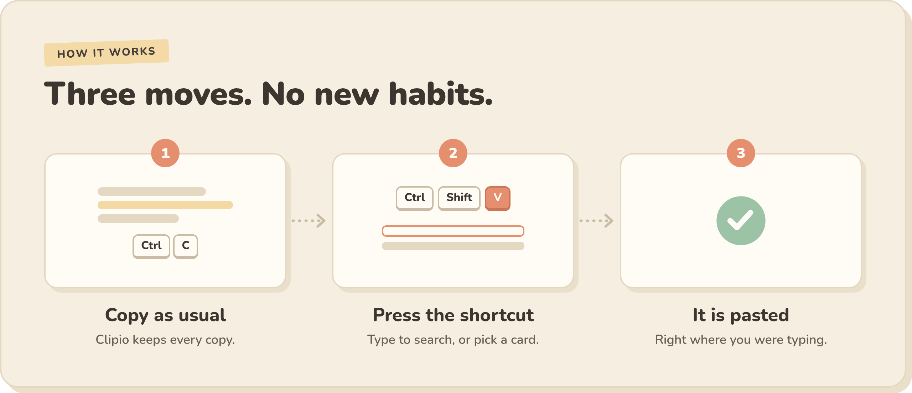
</p>

## 💻 Works on

<p align="center">
  <a href="https://github.com/ardazeybek/clipio/releases/latest/download/Clipio-Setup.exe">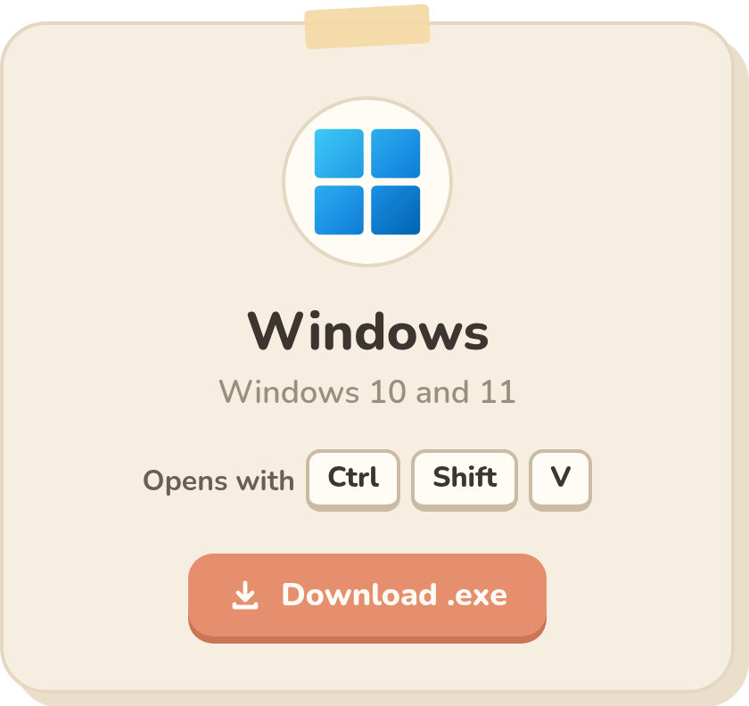</a>
  <a href="https://ardazeybek.github.io/clipio/">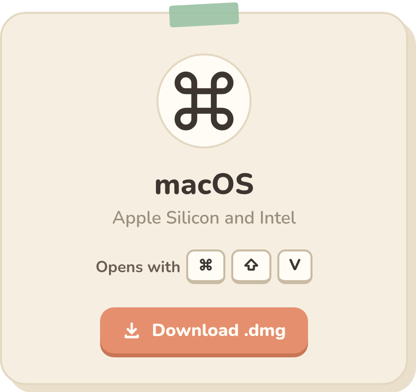</a>
  <a href="https://ardazeybek.github.io/clipio/">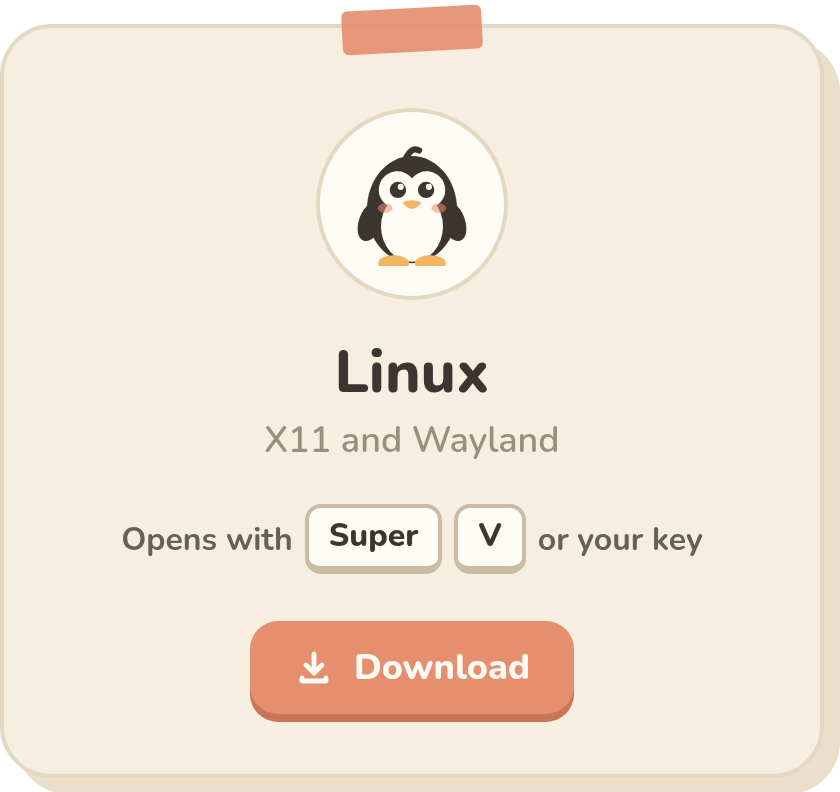</a>
</p>

## 🌟 Features

<p align="center">
  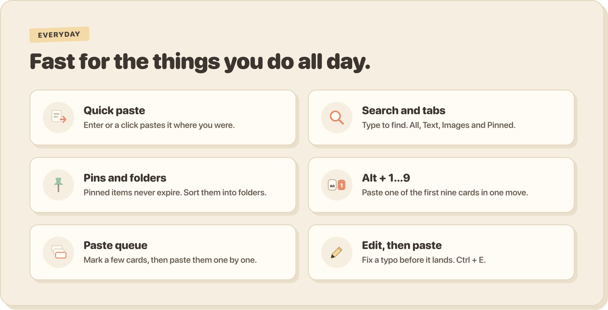
</p>

<p align="center">
  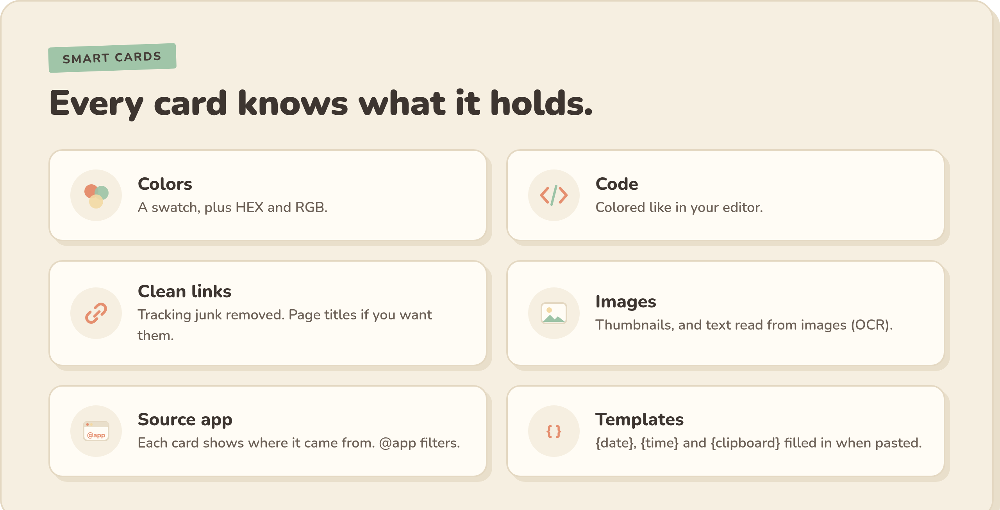
</p>

<p align="center">
  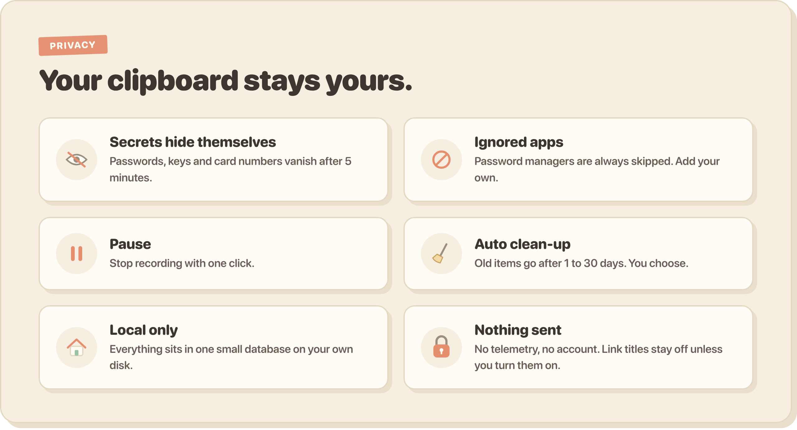
</p>

## 📥 Install

<p align="center">
  <a href="https://ardazeybek.github.io/clipio/">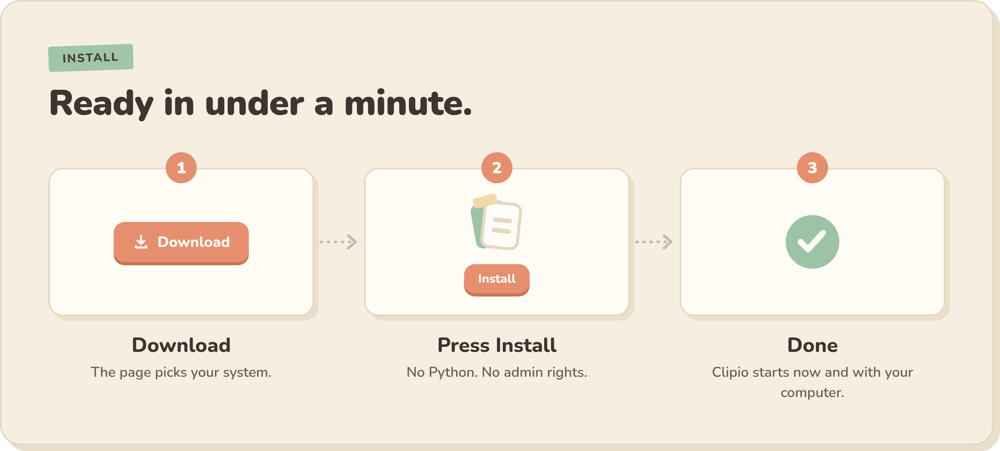</a>
</p>

<p align="center">
  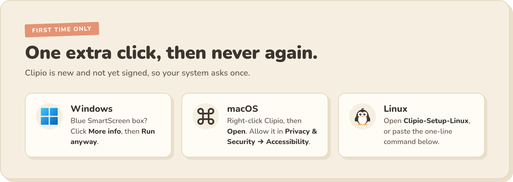
</p>

Linux in one line:

```bash
curl -fsSL https://github.com/ardazeybek/clipio/releases/latest/download/install.sh | sh
```

Developers can install with Python 3.10–3.14 (Linux also needs `wl-clipboard` or `xdotool`):

```bash
pipx install git+https://github.com/ardazeybek/clipio.git
clipio start
clipio autostart on
```

## 🔄 Updates

<p align="center">
  
</p>

## ⌨️ Shortcuts

<p align="center">
  
</p>

## ⚙️ Settings

<p align="center">
  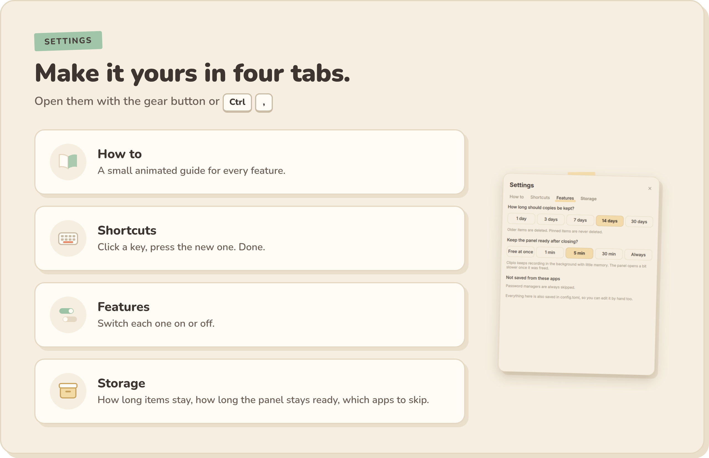
</p>

<p align="center">
  
</p>

## 🐧 Linux Wayland

<p align="center">
  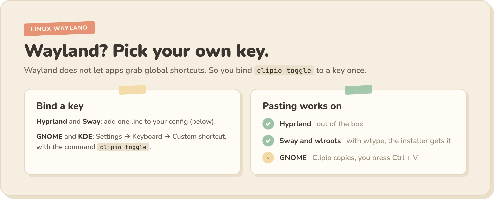
</p>

```ini
# hyprland.conf
bind = SUPER, V, exec, clipio toggle
```

```ini
# sway config
bindsym $mod+v exec clipio toggle
```

## 🍎 macOS

<p align="center">
  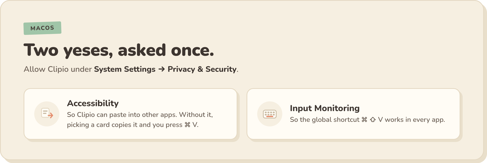
</p>

## 🖥️ Command line

```bash
clipio toggle           # open or close the panel
clipio next             # paste the next item of the paste queue
clipio pause            # stop recording (clipio resume to continue)
clipio retention 7      # keep items for 7 days
clipio update           # look for a new version now
clipio status           # is it running, how many items
clipio start / stop     # start or quit Clipio
clipio uninstall        # remove the app (history stays)
clipio help             # everything else
```

## ❓ FAQ

<p align="center">
  
</p>

## 🛠️ For developers

<p align="center">
  
</p>

```bash
git clone https://github.com/ardazeybek/clipio.git && cd clipio
python -m venv .venv && source .venv/bin/activate   # Windows: .venv\Scripts\activate
pip install -e ".[test]"
clipio run                                          # Ctrl+C stops it
```

## 🤝 Contributing

<p align="center">
  <a href="CONTRIBUTING.md">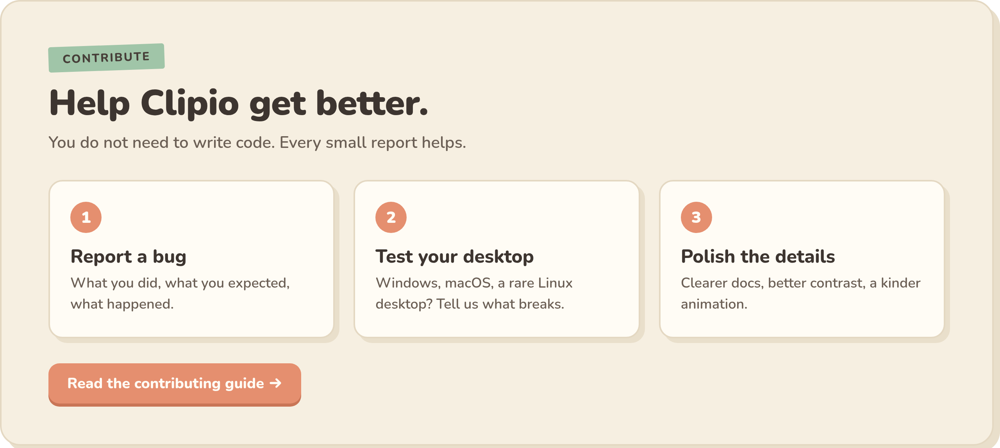</a>
</p>

## 💬 Support

<p align="center">
  <a href="https://github.com/ardazeybek/clipio/issues">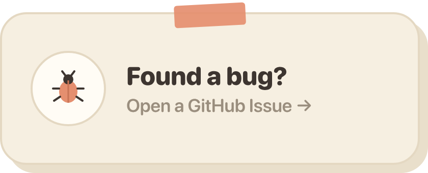</a>
  <a href="https://github.com/ardazeybek/clipio/discussions">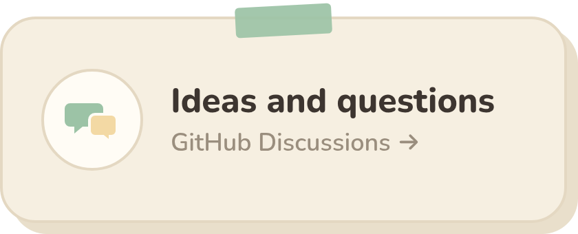</a>
  <a href="mailto:quantastudio.dev@gmail.com">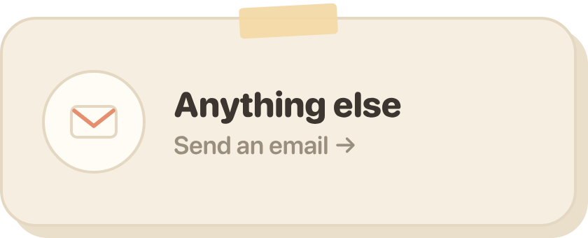</a>
</p>

## 📜 License

<p align="center">
  <a href="LICENSE">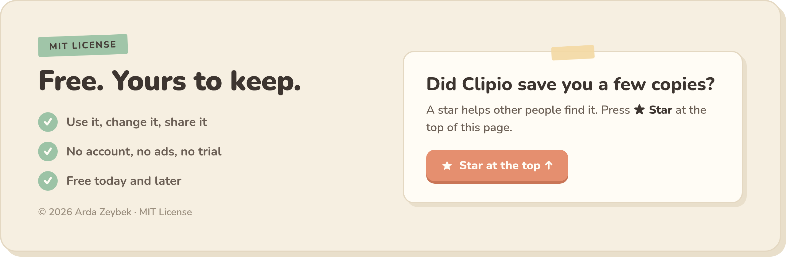</a>
</p>
