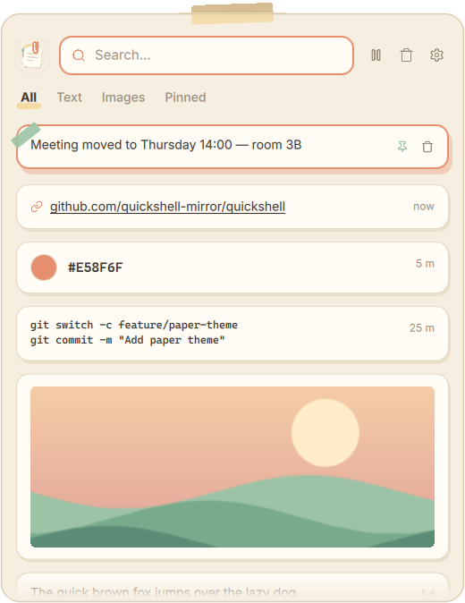

<div align="center">
  
  <h1>Clipio</h1>
  <p><strong>Find and paste anything you copied earlier, with one shortcut on Hyprland.</strong></p>
  <p>A paper-themed clipboard history that remembers your text, links, colors, code and images.</p>
  <p><a href="README.md">English</a> · <a href="README.tr.md">Türkçe</a></p>
  <p>
    <a href="LICENSE"></a>
    
  </p>
  <p><a href="#quick-start">Quick start</a> · <a href="#usage">Usage</a> · <a href="CONTRIBUTING.md">Contribute</a> · <a href="mailto:quantastudio.dev@gmail.com">Contact</a></p>
</div>

<p align="center">
  
</p>

<p align="center"><em>The real Clipio panel with sample data: a pinned note, a link, a color, two lines of code and a copied image.</em></p>

## What is Clipio?

Clipio keeps a history of what you copy on a Hyprland desktop. Press <kbd>Super</kbd> + <kbd>V</kbd>, pick an earlier item, and Clipio pastes it into the window you were using.

It is made for Linux users who run Hyprland and want a simple, good-looking clipboard history. Everything stays on your computer in a local SQLite database. Unpinned items are deleted automatically after the number of days you choose.

Clipio works on **Hyprland (Wayland) only**. It needs Quickshell for its window and wl-clipboard to read and write the clipboard.

## Features

- **One-shortcut history** — Open the panel with <kbd>Super</kbd> + <kbd>V</kbd>, choose an item and it is pasted into the active window. Terminals get <kbd>Ctrl</kbd> + <kbd>Shift</kbd> + <kbd>V</kbd> automatically.
- **Readable cards** — Links, colors, code and images each get their own card, so you can recognise an item at a glance.
- **Search and tabs** — Type to filter, or switch between All, Text, Images and Pinned.
- **Pins that stay** — Pin the things you reuse. Pinned items are never deleted automatically or by *Clear*.
- **Automatic cleanup** — Choose how long items are kept (1, 3, 7, 14 or 30 days) from the settings window.
- **Privacy controls** — Pause recording at any time and list apps whose copies should never be saved.

## Usage

1. Copy something in any app as usual.
2. Press <kbd>Super</kbd> + <kbd>V</kbd>. The panel opens in the middle of the screen.
3. Type to search, or use the arrow keys to move between cards.
4. Press <kbd>Enter</kbd> or click a card. Clipio closes and pastes it.

The panel can be dragged by any empty area. Clicking outside it closes it.

| Key | Action |
| --- | --- |
| <kbd>↑</kbd> <kbd>↓</kbd> · <kbd>PgUp</kbd> <kbd>PgDn</kbd> | Move the selection |
| <kbd>Enter</kbd> · left click | Paste the selected item |
| <kbd>Shift</kbd> + <kbd>Enter</kbd> · right click | Copy it without pasting |
| <kbd>Alt</kbd> + <kbd>1</kbd>–<kbd>9</kbd> | Paste one of the first nine items |
| <kbd>Ctrl</kbd> + <kbd>P</kbd> | Pin or unpin |
| <kbd>Del</kbd> | Delete the selected item |
| <kbd>Tab</kbd> · <kbd>Shift</kbd> + <kbd>Tab</kbd> | Next or previous tab |
| <kbd>Esc</kbd> | Clear the search, then close |

The buttons next to the search field pause recording, clear the history (after a confirmation) and open the settings.

## Quick start

There is no packaged release yet. Clipio runs directly from this repository.

### Requirements

- Hyprland
- [Quickshell](https://quickshell.org) (`quickshell` or `qs` on your `PATH`)
- `wl-clipboard` (`wl-copy`, `wl-paste`)
- Python 3.11 or newer (no extra Python packages)

### Install

```bash
git clone https://github.com/ardazeybek/clipio.git
cd clipio
./install.sh
```

`install.sh` checks the requirements and then:

- creates the `clipio` command in `~/.local/bin`,
- links `ui/` to `~/.config/quickshell/clipio`,
- adds a desktop entry and an icon to `~/.local/share`.

Keep the cloned folder where it is: the command and the Quickshell configuration point to it.

### Connect it to Hyprland

The installer prints the lines to add. For a `hyprland.conf` setup they are:

```ini
exec-once = ~/.local/bin/clipio start
bind = SUPER, V, exec, ~/.local/bin/clipio toggle
```

Reload Hyprland or run `clipio start` once. Copy something, press <kbd>Super</kbd> + <kbd>V</kbd>, and the panel opens.

### Settings

The first run creates `~/.config/clipio/config.toml`. The retention period can also be changed from the panel's settings window.

| Setting | What it does | Default |
| --- | --- | --- |
| `retention_days` | Days before unpinned items are deleted | `14` |
| `max_items` | Maximum number of stored items | `500` |
| `max_text_kb` | Larger texts are not saved | `1024` |
| `max_image_mb` | Larger images are not saved | `25` |
| `max_images_total_mb` | Total size limit for all images | `1024` |
| `persist` | Restore the clipboard when the source app closes | `true` |
| `language` | `auto`, `tr` or `en` | `"auto"` |
| `ignore_apps` | Window classes whose copies are never saved, e.g. `["org.keepassxc.KeePassXC"]` | `[]` |

History is stored in `~/.local/share/clipio/` (`clipio.db`, `images/`, `state.json`).

### Command line

`clipio help` lists every command. The most useful ones:

```bash
clipio start            # start the background service and the panel
clipio toggle           # open or close the panel
clipio pause            # stop recording (clipio resume to continue)
clipio retention 7      # keep items for 7 days and clean up now
clipio status           # item count, pause state and database path
```

## How it works

| Part | Technology | Role |
| --- | --- | --- |
| `daemon/` | Python | Watches the clipboard with `wl-paste --watch` and saves new items |
| `core/` | Python, SQLite | Classifies items, stores them, applies limits and writes `state.json` |
| `cli/` | Python | The `clipio` command: starts things, pastes, pins, deletes |
| `ui/` | Quickshell (QML) | The panel. It reads `state.json` and calls `clipio` for actions |

[MAP.md](MAP.md) describes the full architecture (in Turkish). Each folder has its own `README.md` that explains its files.

## Contributing

Bug reports, documentation fixes, translations, testing on other Hyprland setups and design ideas are all welcome. See [CONTRIBUTING.md](CONTRIBUTING.md) to get started.

## Support and contact

- **Bugs and feature requests:** [GitHub Issues](https://github.com/ardazeybek/clipio/issues)
- **Other questions:** [quantastudio.dev@gmail.com](mailto:quantastudio.dev@gmail.com)

## License

Clipio is released under the [MIT License](LICENSE).
