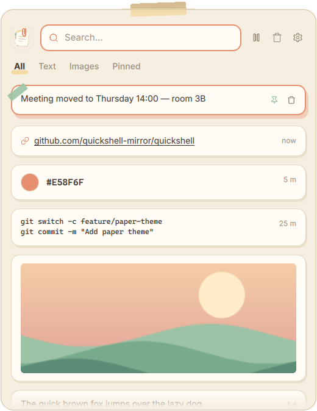

<div align="center">
  
  <h1>Clipio</h1>
  <p><strong>Hyprland'de daha önce kopyaladığın her şeyi tek kısayolla bul ve yapıştır.</strong></p>
  <p>Metinleri, bağlantıları, renkleri, kodu ve resimleri hatırlayan kağıt temalı bir pano geçmişi.</p>
  <p><a href="README.md">English</a> · <a href="README.tr.md">Türkçe</a></p>
  <p>
    <a href="LICENSE"></a>
    
  </p>
  <p><a href="#hızlı-başlangıç">Hızlı başlangıç</a> · <a href="#kullanım">Kullanım</a> · <a href="CONTRIBUTING.md">Katkıda bulun</a> · <a href="mailto:quantastudio.dev@gmail.com">İletişim</a></p>
</div>

<p align="center">
  
</p>

<p align="center"><em>Örnek verilerle gerçek Clipio paneli: sabitlenmiş bir not, bir bağlantı, bir renk, iki satır kod ve kopyalanmış bir resim.</em></p>

## Clipio nedir?

Clipio, Hyprland masaüstünde kopyaladıklarının geçmişini tutar. <kbd>Super</kbd> + <kbd>V</kbd> tuşlarına bas, önceki bir öğeyi seç; Clipio onu kullandığın pencereye yapıştırır.

Hyprland kullanan ve sade, güzel görünen bir pano geçmişi isteyen Linux kullanıcıları için yapıldı. Her şey bilgisayarında, yerel bir SQLite veritabanında kalır. Sabitlenmemiş öğeler, seçtiğin gün sayısı dolunca kendiliğinden silinir.

Clipio **yalnızca Hyprland (Wayland)** üzerinde çalışır. Penceresi için Quickshell'e, panoyu okuyup yazmak için wl-clipboard'a ihtiyaç duyar.

## Öne çıkan özellikler

- **Tek kısayolla geçmiş** — Paneli <kbd>Super</kbd> + <kbd>V</kbd> ile aç, bir öğe seç; etkin pencereye yapıştırılır. Terminallere otomatik olarak <kbd>Ctrl</kbd> + <kbd>Shift</kbd> + <kbd>V</kbd> gönderilir.
- **Okunaklı kartlar** — Bağlantı, renk, kod ve resimlerin her biri kendi kartıyla görünür; öğeyi bir bakışta tanırsın.
- **Arama ve sekmeler** — Yazarak süz ya da Tümü, Metin, Resim ve Sabit sekmeleri arasında geç.
- **Kalıcı sabitler** — Sık kullandıklarını sabitle. Sabitlenen öğeler ne otomatik temizlikte ne de *Temizle* ile silinir.
- **Otomatik temizlik** — Öğelerin ne kadar saklanacağını (1, 3, 7, 14 ya da 30 gün) ayarlar penceresinden seç.
- **Gizlilik denetimi** — Kaydı istediğin an duraklat; kopyaları hiç kaydedilmeyecek uygulamaları listele.

## Kullanım

1. Herhangi bir uygulamada her zamanki gibi bir şey kopyala.
2. <kbd>Super</kbd> + <kbd>V</kbd> tuşlarına bas. Panel ekranın ortasında açılır.
3. Aramak için yaz ya da kartlar arasında ok tuşlarıyla gez.
4. <kbd>Enter</kbd>'a bas ya da karta tıkla. Clipio kapanır ve öğeyi yapıştırır.

Panel boş bir yerinden tutularak sürüklenebilir. Dışına tıklayınca kapanır.

| Tuş | İşlem |
| --- | --- |
| <kbd>↑</kbd> <kbd>↓</kbd> · <kbd>PgUp</kbd> <kbd>PgDn</kbd> | Seçimi taşı |
| <kbd>Enter</kbd> · sol tık | Seçili öğeyi yapıştır |
| <kbd>Shift</kbd> + <kbd>Enter</kbd> · sağ tık | Yapıştırmadan yalnızca kopyala |
| <kbd>Alt</kbd> + <kbd>1</kbd>–<kbd>9</kbd> | İlk dokuz öğeden birini yapıştır |
| <kbd>Ctrl</kbd> + <kbd>P</kbd> | Sabitle ya da sabitlemeyi kaldır |
| <kbd>Del</kbd> | Seçili öğeyi sil |
| <kbd>Tab</kbd> · <kbd>Shift</kbd> + <kbd>Tab</kbd> | Sonraki ya da önceki sekme |
| <kbd>Esc</kbd> | Önce aramayı temizle, sonra kapat |

Arama kutusunun yanındaki butonlar kaydı duraklatır, geçmişi (onay sorduktan sonra) temizler ve ayarları açar.

## Hızlı başlangıç

Henüz paketlenmiş bir sürüm yok. Clipio doğrudan bu depodan çalışır.

### Gereksinimler

- Hyprland
- [Quickshell](https://quickshell.org) (`PATH` içinde `quickshell` ya da `qs`)
- `wl-clipboard` (`wl-copy`, `wl-paste`)
- Python 3.11 veya üstü (ek Python paketi gerekmez)

### Kurulum

```bash
git clone https://github.com/ardazeybek/clipio.git
cd clipio
./install.sh
```

`install.sh` önce gereksinimleri denetler, sonra:

- `~/.local/bin` içine `clipio` komutunu oluşturur,
- `ui/` klasörünü `~/.config/quickshell/clipio` konumuna bağlar,
- `~/.local/share` içine bir masaüstü girdisi ve simge ekler.

Klonladığın klasörü yerinde bırak: komut ve Quickshell yapılandırması o klasörü gösterir.

### Hyprland'e bağlama

Kurulum betiği eklenecek satırları yazdırır. `hyprland.conf` kullanıyorsan bunlar:

```ini
exec-once = ~/.local/bin/clipio start
bind = SUPER, V, exec, ~/.local/bin/clipio toggle
```

Hyprland'i yeniden yükle ya da bir kez `clipio start` çalıştır. Bir şey kopyala, <kbd>Super</kbd> + <kbd>V</kbd>'ye bas; panel açılır.

### Ayarlar

İlk çalıştırmada `~/.config/clipio/config.toml` oluşturulur. Saklama süresi panelin ayarlar penceresinden de değiştirilebilir.

| Ayar | Ne işe yarar? | Varsayılan |
| --- | --- | --- |
| `retention_days` | Sabitlenmemiş öğeler kaç gün sonra silinir | `14` |
| `max_items` | En fazla kaç öğe saklanır | `500` |
| `max_text_kb` | Bundan büyük metinler kaydedilmez | `1024` |
| `max_image_mb` | Bundan büyük resimler kaydedilmez | `25` |
| `max_images_total_mb` | Tüm resimlerin toplam boyut sınırı | `1024` |
| `persist` | Kaynak uygulama kapanınca panoyu geri yükler | `true` |
| `language` | `auto`, `tr` ya da `en` | `"auto"` |
| `ignore_apps` | Kopyaları hiç kaydedilmeyecek pencere sınıfları, ör. `["org.keepassxc.KeePassXC"]` | `[]` |

Geçmiş `~/.local/share/clipio/` içinde tutulur (`clipio.db`, `images/`, `state.json`).

### Komut satırı

`clipio help` tüm komutları listeler. En kullanışlıları:

```bash
clipio start            # arka plan servisini ve paneli başlat
clipio toggle           # paneli aç ya da kapat
clipio pause            # kaydı durdur (sürdürmek için clipio resume)
clipio retention 7      # öğeleri 7 gün sakla ve hemen temizle
clipio status           # öğe sayısı, duraklatma durumu ve veritabanı yolu
```

## Nasıl çalışır?

| Bölüm | Teknoloji | Görevi |
| --- | --- | --- |
| `daemon/` | Python | Panoyu `wl-paste --watch` ile izler ve yeni öğeleri kaydeder |
| `core/` | Python, SQLite | Öğeleri sınıflandırır, saklar, sınırları uygular ve `state.json` yazar |
| `cli/` | Python | `clipio` komutu: başlatır, yapıştırır, sabitler, siler |
| `ui/` | Quickshell (QML) | Panel. `state.json` okur, işlemler için `clipio` çağırır |

[MAP.md](MAP.md) tüm mimariyi anlatır. Her klasörde, içindeki dosyaları açıklayan bir `README.md` vardır.

## Katkıda bulunma

Hata bildirimleri, dokümantasyon düzeltmeleri, çeviriler, farklı Hyprland kurulumlarında test ve tasarım önerileri memnuniyetle karşılanır. Başlamak için [CONTRIBUTING.md](CONTRIBUTING.md) dosyasına bak.

## Destek ve iletişim

- **Hatalar ve özellik istekleri:** [GitHub Issues](https://github.com/ardazeybek/clipio/issues)
- **Diğer sorular:** [quantastudio.dev@gmail.com](mailto:quantastudio.dev@gmail.com)

## Lisans

Clipio [MIT Lisansı](LICENSE) ile yayımlanır.
